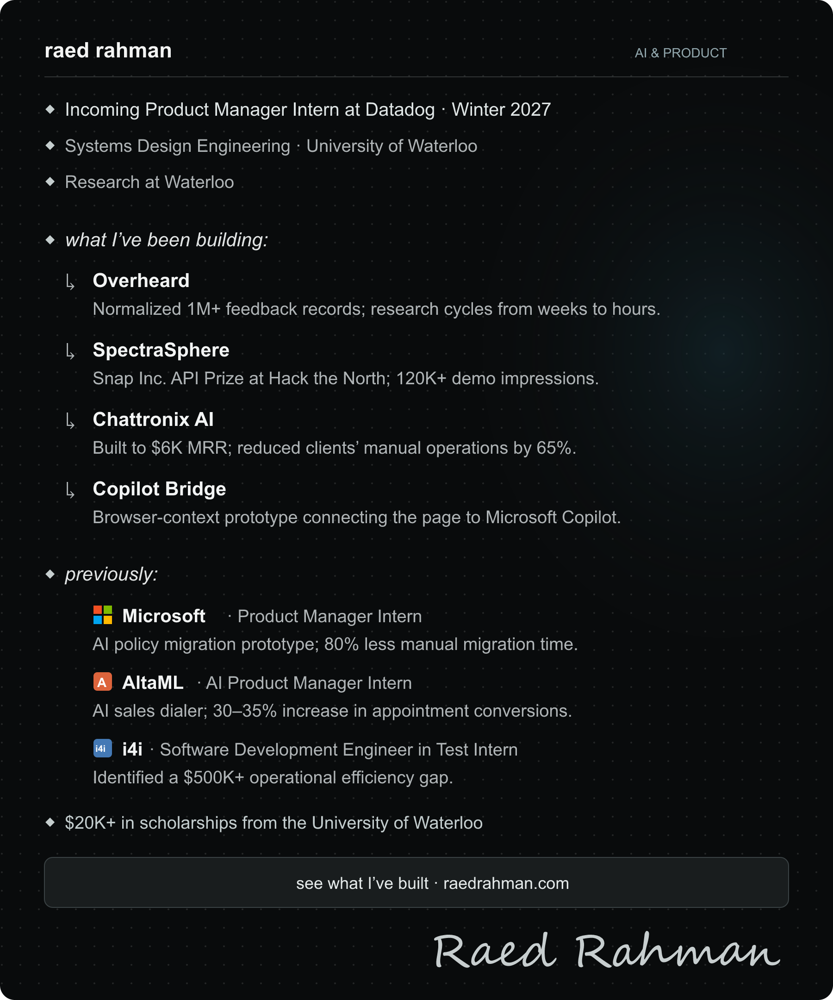

  <a href="https://raedrahman.com">Portfolio</a> &nbsp;·&nbsp;
  <a href="https://www.linkedin.com/in/raed-rahman-a59073203/">LinkedIn</a> &nbsp;·&nbsp;
  <a href="mailto:raedrahman43@gmail.com">Email</a> &nbsp;·&nbsp;
  <a href="https://x.com/raed_r43">X</a>

  <a href="https://github.com/raedrahman43/OverHeard">Overheard</a> &nbsp;·&nbsp;
  <a href="https://github.com/raedrahman43/SpectraSphere">SpectraSphere</a> &nbsp;·&nbsp;
  <a href="https://github.com/raedrahman43/ChatTronix-AI">Chattronix AI</a> &nbsp;·&nbsp;
  <a href="https://github.com/raedrahman43/Copilot-Bridge">Copilot Bridge</a>

Read the text version

### Raed Rahman · AI & Product

- Incoming Product Manager Intern at **Datadog**, Winter 2027.
- **Systems Design Engineering** at the University of Waterloo.
- **Research at Waterloo**.
- **$20K+ in scholarships** from the University of Waterloo.

### What I’ve been building

- **[Overheard](https://github.com/raedrahman43/OverHeard):** normalized **1M+ feedback records**, reducing research cycles from weeks to hours.
- **[SpectraSphere](https://github.com/raedrahman43/SpectraSphere):** won the **Snap Inc. API Prize at Hack the North 2025**; **120K+ demo impressions**.
- **[Chattronix AI](https://github.com/raedrahman43/ChatTronix-AI):** built to **$6K MRR**, reducing clients’ manual operations by **65%**.
- **[Copilot Bridge](https://github.com/raedrahman43/Copilot-Bridge):** browser-context prototype connecting the page to Microsoft Copilot.

### Previously

- **Microsoft · Product Manager Intern:** AI policy migration prototype; **80% less manual migration time**, working with engineers, security architects, and Fortune 100 companies.
- **AltaML · AI Product Manager Intern:** AI sales dialer; **30–35% increase in appointment conversions**.
- **i4i · Software Development Engineer in Test Intern:** identified a **$500K+ operational efficiency gap**.

[See my full portfolio](https://raedrahman.com)

*Raed Rahman*

