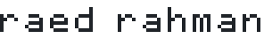
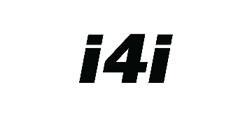

<h1>
  <picture>
    <source media="(prefers-color-scheme: dark)" srcset="assets/name-dark.svg">
    <source media="(prefers-color-scheme: light)" srcset="assets/name-light.svg">
    
  </picture>
</h1>

**AI & Product**

<table>
  <tr>
    <td width="64" align="center" valign="middle"></td>
    <td><strong>Incoming Product Manager Intern at Datadog</strong> Winter 2027</td>
  </tr>
  <tr>
    <td width="64" align="center" valign="middle"></td>
    <td><strong>Systems Design Engineering</strong> University of Waterloo &middot; $20K+ in scholarships</td>
  </tr>
</table>

 

### *what I've been building:*

  <strong><a href="https://github.com/raedrahman43/OverHeard">Overheard</a></strong> 
  Normalized <strong>1M+ feedback records</strong>; research cycles from <strong>weeks to hours</strong>.

  <strong><a href="https://github.com/raedrahman43/SpectraSphere">SpectraSphere</a></strong> 
  <strong>Snap Inc. API Prize at Hack the North 2025</strong>; <strong>120K+ demo impressions</strong>.

  <strong><a href="https://github.com/raedrahman43/ChatTronix-AI">Chattronix AI</a></strong> 
  Built to <strong>$6K MRR</strong>; reduced clients' manual operations by <strong>65%</strong>.

  <strong><a href="https://github.com/raedrahman43/Copilot-Bridge">Copilot Bridge</a></strong> 
  Browser-context prototype connecting the page to <strong>Microsoft Copilot</strong>.

 

### *previously:*

<table>
  <tr>
    <td width="64" align="center" valign="middle"></td>
    <td>
      <strong>Microsoft</strong> 
      Product Manager Intern
      
AI policy migration prototype; <strong>80% less manual migration time</strong>, working with engineers, security architects, and Fortune 100 companies.

    </td>
  </tr>
  <tr>
    <td width="64" align="center" valign="middle"></td>
    <td>
      <strong>AltaML</strong> 
      AI Product Manager Intern
      
AI sales dialer; <strong>30-35% increase in appointment conversions</strong>.

    </td>
  </tr>
  <tr>
    <td width="64" align="center" valign="middle"></td>
    <td>
      <strong>i4i</strong> 
      Software Development Engineer in Test Intern
      
Identified a <strong>$500K+ operational efficiency gap</strong>.

    </td>
  </tr>
  <tr>
    <td width="64" align="center" valign="middle"></td>
    <td><strong>Research at UWaterloo</strong></td>
  </tr>
</table>

 

---

<strong><a href="https://raedrahman.com">See what I've built &middot; raedrahman.com</a></strong>

  <a href="https://www.linkedin.com/in/raed-rahman-a59073203/">LinkedIn</a> &nbsp;&middot;&nbsp;
  <a href="mailto:raedrahman43@gmail.com">Email</a> &nbsp;&middot;&nbsp;
  <a href="https://x.com/raed_r43">X</a>

